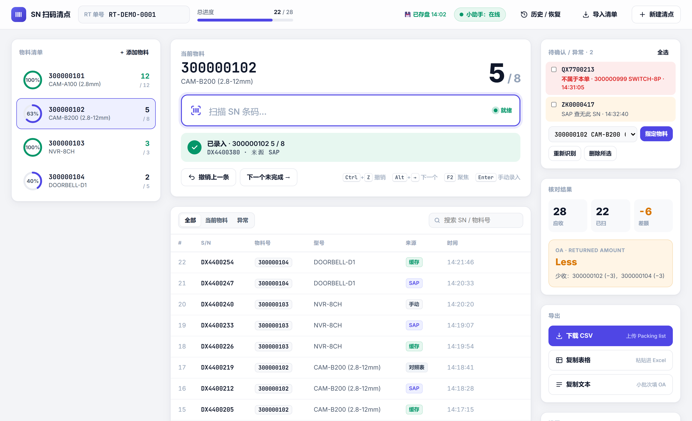
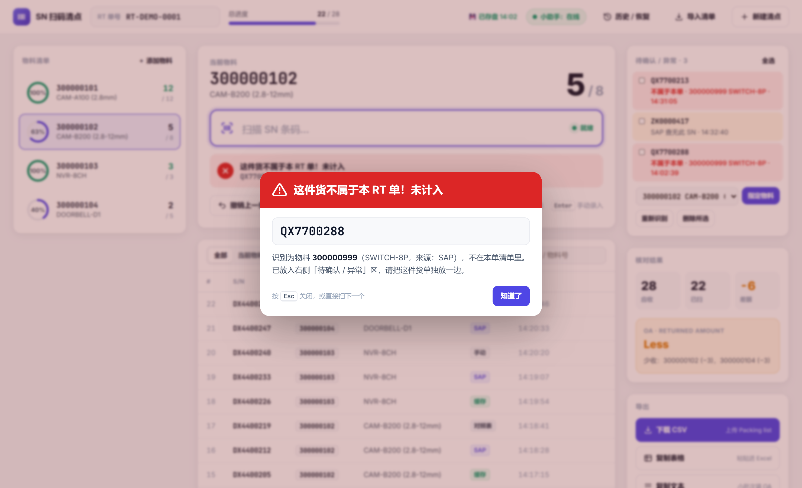
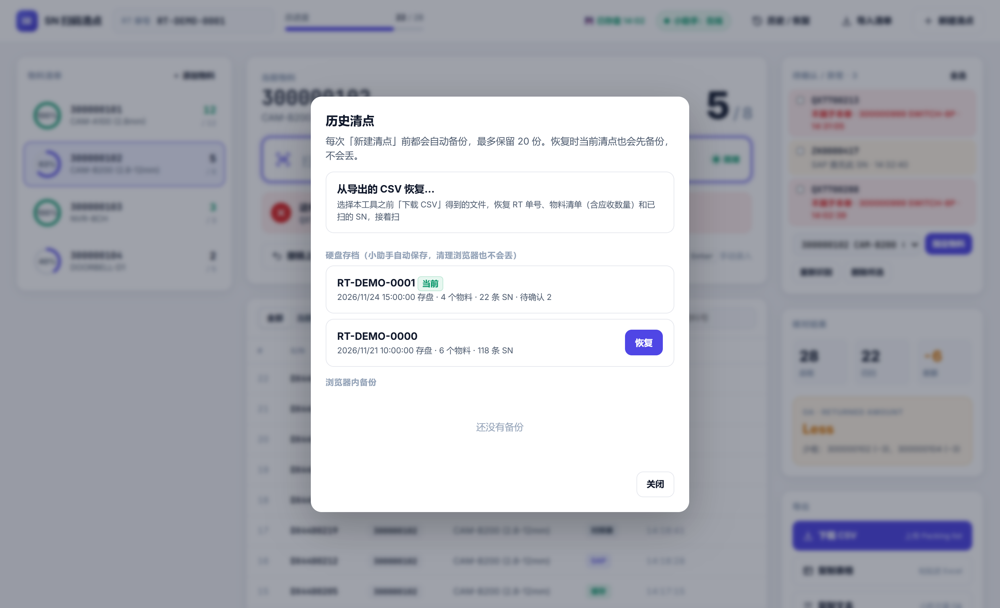
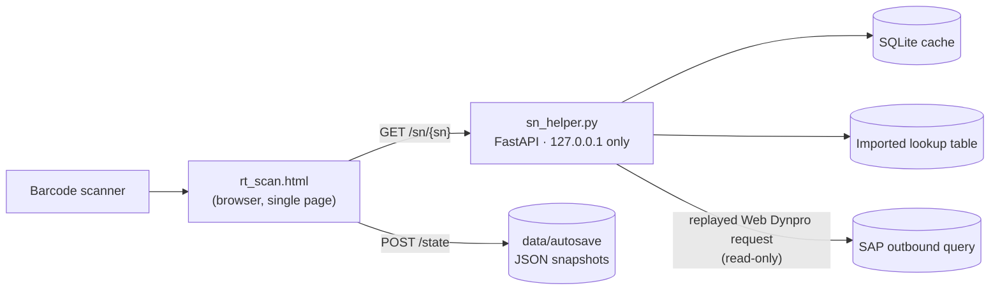

# SN Scan Helper · RT 退货扫码清点助手

**Scan a serial number, get the material code automatically.**
A small local tool for warehouse return (RT) counting: barcode scanner → browser page → a local Python helper that looks up each serial number in SAP and sorts the item into the right material line — no more picking the material by hand before every scan.

[English](#english) · [中文](#中文)



---

## English

### The problem

When counting returned goods, every unit's serial number (SN) is scanned and has to be booked under its material code. The old workflow: select the material in the list first, then scan. With hundreds of mixed units per return order, that is slow and error-prone — and the mapping *SN → material* already exists in SAP, just not where the scanner is.

### What it does

- **Auto-identify** — each scanned SN is looked up (local cache → imported lookup table → live SAP query) and counted under the right material, with its source shown (SAP / cache / table / manual).
- **Never drops a scan** — scans go into a queue that is processed one at a time; the scanner never has to wait for SAP (~3–5 s per live lookup, cache hits are instant).
- **Return-order checks** — an item whose material is *not* on the return order raises a red alarm and is set aside; duplicates, mis-scanned material codes / EAN codes are caught too.
- **Blind counting mode** — no order list? Materials are created on the fly from SAP results, with model names.
- **Pending area** — not found / helper offline / no list yet → items wait in a "to confirm" area, can be batch-assigned, and are retried automatically when the helper comes back.
- **Data safety** — single-writer tab lock (a second tab becomes read-only), automatic disk snapshots via the helper (atomic writes + previous version kept), loud warning if the browser cannot save, automatic backups before "new count" / "import list", restore from history, disk snapshot or exported CSV.
- **Export** — CSV for the packing list (with an *identification source* column), copy as table / text.

| Not on this return order → alarm | Restore from disk snapshots |
|---|---|
|  |  |

### How it works



- **No API? Replay the UI.** The SAP system offers no OData service, only a Web Dynpro screen. The helper drives a real Chrome window (Playwright, persistent profile) where the user logs in **manually** — the tool never sees the password. After login it reads the session parameters from the page and replays the same `SAPEVENTQUEUE` POST the screen would send (input change + button press), then parses the material code from the response. Strictly read-only.
- **Self-healing session.** Expired session → reopen the query page and retry once; login required → HTTP 401 and a "needs login" badge; Chrome window closed by the user → it is reopened automatically.
- **Local-only by design.** The helper binds to `127.0.0.1`, checks the `Host` header (DNS rebinding), rejects foreign `Origin`s and requires a custom `X-SN-Helper` header on API calls (blocks cross-site form posts / `no-cors` requests). SNs are validated (`[A-Z0-9-]{4,32}`) before anything is sent to SAP.

### Run it

Windows, Python 3.11+, Google Chrome or Microsoft Edge.

```powershell
python -m venv .venv
.\.venv\Scripts\pip install playwright fastapi uvicorn openpyxl python-multipart
copy config.example.json config.json   # then fill in your SAP system
.\start.bat
```

`start.bat` starts the helper and opens `http://127.0.0.1:8765/`. Log in to SAP in the Chrome window it opens; the badge turns green ("helper online").
Without a `config.json` the helper still runs (cache, lookup table, disk snapshots) — only live SAP lookups are off.

> The SAP part is written for one specific Web Dynpro "outbound query" app (one serial-number input + a query button, results table with material / serial / model columns). Other systems will need their own `parse` logic in `sn_helper.py`.

### Files

| File | |
|---|---|
| `rt_scan.html` | The whole front end — single file, no build step, state in `localStorage` |
| `sn_helper.py` | Local helper: lookup chain, SAP session handling, import, disk snapshots, access guard |
| `start.bat` | One-click start |
| `config.example.json` | Template for the local SAP connection settings (`config.json` is git-ignored) |

### Notes

Built as a personal side project to speed up my own daily work. Not affiliated with or endorsed by any company or SAP. The repository contains no company data; screenshots use made-up data.

---

## 中文

### 解决什么问题

RT 退货清点时，每件货都要扫 SN，并记到对应的物料号下。原来的做法是：先在左侧选好物料，再扫码。一张单几百件、物料混在一起时，又慢又容易错。而 SN → 物料号 的对应关系其实 SAP 里早就有，只是不在扫码枪这边。

### 功能

- **自动识别物料**：扫 SN 后依次查本地缓存 → 导入的对照表 → 实时查 SAP，自动归到对应物料，并标出来源（SAP / 缓存 / 对照表 / 手动）。
- **连扫不丢码**：扫码先进队列，后台逐个识别；扫码枪不用等 SAP（实时查询约 3–5 秒，缓存命中瞬间完成）。
- **按单核对**：查到的物料不在本 RT 单里 → 红色报警并放到异常区；重复扫码、误扫物料号 / EAN 码也会拦下。
- **无单盲点模式**：没有清单时，按 SAP 结果自动新建物料（带型号）。
- **待确认区**：查不到、小助手离线、还没导入清单的货先放这里，可批量指定物料；小助手恢复后自动重新识别。
- **数据安全**：同一时间只有一个标签页能写（其它标签页自动只读）；经小助手自动存档到硬盘（原子写入 + 保留旧版本）；浏览器保存失败会红条报警；新建 / 导入清单前自动备份；可从历史、硬盘存档或导出的 CSV 恢复。
- **导出**：Packing list 用的 CSV（含「识别来源」列），也可复制成表格或文本。

### 原理

- **没有接口就复现界面请求**：这套 SAP 没开 OData，只有 Web Dynpro 页面。小助手用 Playwright 驱动一个真实的 Chrome 窗口（持久化 profile），由用户**自己手动登录**，程序不接触密码。登录后从页面读出会话参数，直接复现页面查询时发出的 `SAPEVENTQUEUE` 请求（输入框变更 + 按下查询按钮），再从返回结果里解析物料号。全程只读。
- **会话自愈**：会话过期就重开查询页再试一次；需要登录时返回 401，页面显示「SAP 需登录」；SAP 窗口被关掉会自动重新打开。
- **只在本机可用**：只监听 `127.0.0.1`，校验 `Host`（防 DNS 重绑定）、拒绝外来 `Origin`，API 必须带自定义头 `X-SN-Helper`（防跨站表单 / no-cors 请求）；发给 SAP 之前先校验 SN 格式（`[A-Z0-9-]{4,32}`）。

### 运行

需要 Windows、Python 3.11+、Chrome 或 Edge。步骤见上方英文部分的命令：建虚拟环境 → 安装依赖 → 把 `config.example.json` 复制为 `config.json` 并填写自己的 SAP 系统 → 双击 `start.bat`，在弹出的 Chrome 里登录 SAP。

没有 `config.json` 时小助手照常运行（缓存、对照表、硬盘存档都能用），只是不做实时 SAP 查询。

> SAP 部分针对的是一个特定的 Web Dynpro「出库查询」应用（一个序列号输入框 + 查询按钮，结果表含物料 / 序列号 / 型号列）。换成别的系统，需要按实际页面调整 `sn_helper.py` 里的解析逻辑。

### 说明

这是我为了提高自己日常工作效率做的个人业余项目，与任何公司或 SAP 无隶属或背书关系。仓库里不含任何公司数据，截图均为虚构数据。
